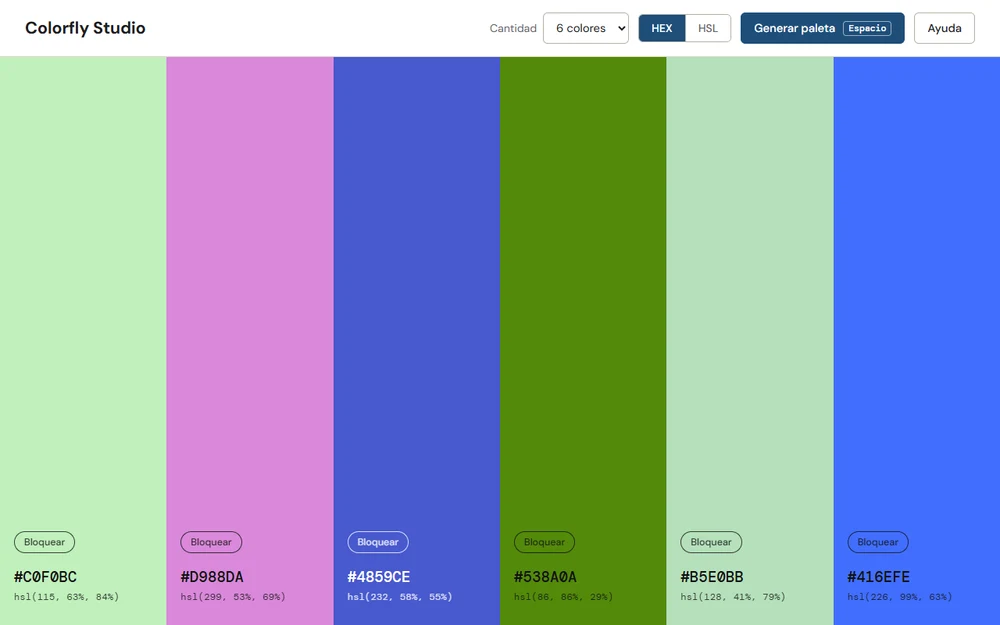
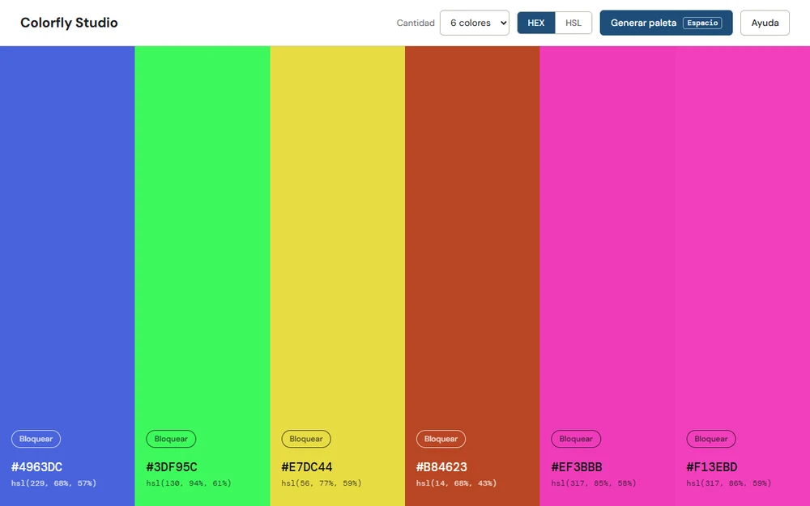
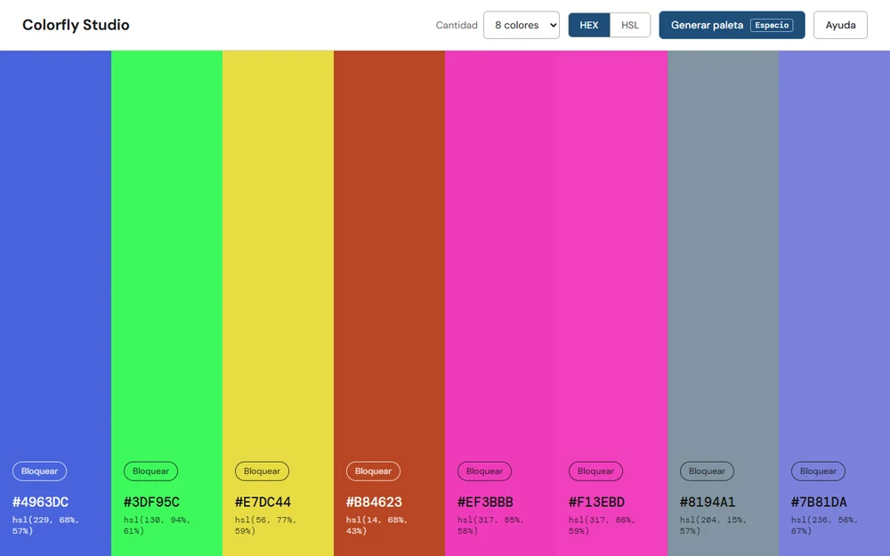

# Colorfly Studio

Generador de paletas de colores. Arma una paleta con un botón, deja bloquear los colores que gustan y copia sus valores en HEX o HSL. Está hecho con HTML, CSS y JavaScript, sin dependencias.

Demo: https://colorfly-studio.vercel.app





Más trabajos en mi portfolio: https://portfolio-fawn-kappa-35.vercel.app

## Qué hace

- Genera una paleta nueva con el botón "Generar paleta" o con la barra espaciadora.
- La paleta puede tener 6, 8 o 9 colores.
- Cada color tiene un botón para bloquearlo. Al generar de nuevo, los bloqueados no cambian.
- Los valores se muestran en HEX o en HSL, y con un clic en cualquiera se copia al portapapeles. Aparece un aviso con lo que se copió.
- El texto de cada color es blanco o negro según la luminosidad del fondo, para que se lea.
- La última paleta, su tamaño y los colores bloqueados se guardan en `localStorage`, así que sobreviven a una recarga.
- En pantallas angostas cada color pasa a ser una franja horizontal.
- La ayuda se abre con el botón "Ayuda" y se cierra con Escape.

## Cómo correrlo

No hay nada que instalar. Se abre `index.html` en el navegador, o se sirve la carpeta con cualquier servidor estático:

```bash
python -m http.server 8000
```

La API del portapapeles necesita `localhost` o HTTPS. Abierta como archivo, la página usa un método de respaldo para copiar.

## Archivos

```
index.html   estructura y ayuda
style.css    estilos
app.js       generación de colores, bloqueo, formatos, guardado y copiado
```

## Notas del código

- El estado es un arreglo de objetos `{ hex, hsl, locked }`. Generar, bloquear y cambiar el tamaño modifican ese arreglo y vuelven a dibujar la paleta.
- Los colores se eligen al azar sin ningún criterio de armonía.
- Antes de usar lo que hay en `localStorage` se valida que cada color tenga un HEX válido; si no, se genera una paleta nueva.

## Despliegue

Está publicada en Vercel: https://colorfly-studio.vercel.app. Al ser una página estática, sirve cualquier hosting estático.
